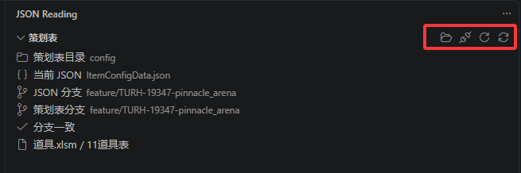
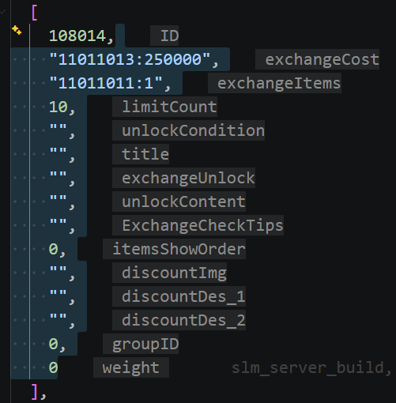
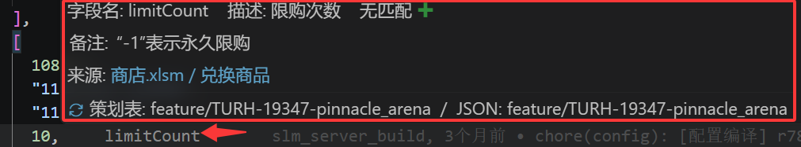
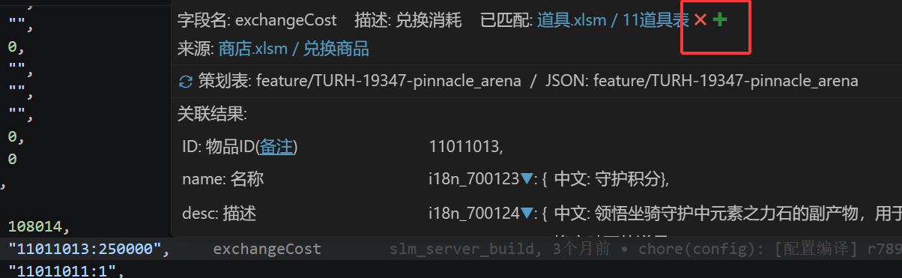
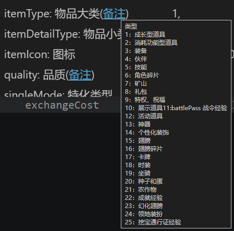

# JSON Reading

## 介绍

JSON Reading 是一个面向表格型 JSON / JSONC 配置的 VS Code 扩展。它把字段名显示在数据行末，并结合本地策划表提供字段描述、备注、来源跳转和关联数据查询，让阅读配置时可以直接看懂每个值的含义。

主要功能：

- **行尾字段提示**：根据首行表头显示字段名，支持选中行或全部行模式。
- **策划表说明**：悬停查看 XLSM 中的描述和备注，点击链接打开来源工作簿。
- **关联与级联查询**：查看当前值对应的记录，继续展开下级关联及中文翻译。
- **手动管理关联**：通过加号指定匹配目标，确认、排除或恢复已有关系。
- **侧栏管理**：绑定策划表目录、查看分支状态，并按当前 JSON 分支更新策划仓库。

适用的数据格式如下：外层数组的第一个元素是字段名数组，后续每个数组是一条记录，字段和值按位置对应。

```json
[
  ["ID", "Name", "Rewards"],
  [1001, "i18n_1001", [2001, 2002]],
  [1002, "i18n_1002", [2003]]
]
```

普通 JSON 对象不属于这种表格格式。字段提示只是编辑器中的显示效果，不会写入文件或影响复制内容。

## 安装

需要 **VS Code 桌面版 1.140.0 或更高版本**。从 GitHub Release 下载以下文件：

| 文件下载 | 使用说明 |
| --- | --- |
| [json-reading-0.0.1.vsix](https://github.com/fisherman1200/json-reading/releases/download/v0.0.1/json-reading-0.0.1.vsix) | 扩展安装包。按下方步骤安装后，前往[快速使用](#快速使用)打开项目并绑定策划表。 |
| [relations.json](https://github.com/fisherman1200/json-reading/releases/download/v0.0.1/relations.json) | 预匹配表，提供预先整理的字段关联规则。下载后按[添加预匹配表](#3-添加预匹配表)放入业务项目。 |

以上链接对应 `v0.0.1` Release，发布并上传同名附件后即可下载。其他版本可在 [Releases 页面](https://github.com/fisherman1200/json-reading/releases)查看。

安装扩展：

1. 下载上表中的 `json-reading-0.0.1.vsix`。
2. 打开 VS Code 左侧的**扩展**视图。
3. 点击右上角 **… → 从 VSIX 安装…**，选择安装包。
4. 按提示重新加载窗口。

也可以在安装包所在目录执行：

```sh
code --install-extension json-reading-0.0.1.vsix
```

安装和日常使用无需安装 Node.js。字段提示及 XLSM 内容读取也不要求安装 Excel；打开工作簿、自动定位页签和 Git 同步的环境要求见[其他说明](#其他说明)。

## 快速使用

### 1. 打开项目与 JSON

在 VS Code 中打开业务项目文件夹，再打开一份上述格式的 JSON / JSONC。将光标放在数据行，行尾即可看到对应字段名；选中多行时，会同时显示这些行的字段名。

### 2. 绑定策划表目录

点击活动栏中的 **JSON Reading** 图标，在**策划表**视图右上角点击文件夹按钮，从https://tygit.tuyoo.com/133-slm/share/planning_config 拉取策划表后，选择**本机**的策划表根目录。目录内应包含 `注册表.xlsm` 和对应的 XLSM 工作簿，可以放在子目录中。读取策划表需要工作区处于受信任状态。



图中红框内的按钮从左到右分别是：

| 按钮 | 用途 |
| --- | --- |
| 选择目录 | 选择或更换本机策划表目录。 |
| 解除绑定 | 清空目录配置，之后可重新绑定；不删除策划文件或共享匹配规则。 |
| 刷新索引 | 重新读取本地策划表信息，适用于表格更新后手动刷新。 |
| 同步分支 | 按当前 JSON 所在分支，切换并拉取策划仓库的同名分支。 |

侧栏同时显示当前 JSON、双方分支、分支是否一致，以及对应的工作簿和页签。每位成员需要绑定自己的本地目录；仅查看行尾字段名时可以跳过此步骤。

### 3. 添加预匹配表

下载安装部分的 [relations.json](https://github.com/fisherman1200/json-reading/releases/download/v0.0.1/relations.json)，放到**当前打开的业务项目根目录**下，保持文件名为 `relations.json`：

```text
业务项目/
└─ extensions/
   └─ json_reading/
      └─ relations.json
```

如果目录不存在，先创建 `extensions/json_reading/`。此文件放在业务项目中，不放在 VS Code 扩展安装目录或策划表目录。项目已经有这份文件时，先备份并合并需要的规则，避免覆盖已有的确认、排除和手动添加记录。

保存后扩展会重新读取规则，回到业务数据 JSON，再次悬停字段即可查看已配置的匹配关系和当前值对应的关联结果；没有及时更新时，可以点击策划表侧栏的“刷新索引”。`relations.json` 本身不显示字段提示。

预匹配表中的 JSON 路径、字段及工作簿信息需要与当前业务项目和策划目录对应；其他项目需要使用各自的规则，或通过绿色 **✚** 手动添加。

只使用字段名、描述和备注时，可以跳过此步骤。VSIX 不会自动安装预匹配表；团队也可以将这份文件直接提交到业务仓库，后续成员拉取项目即可获得规则。

### 4. 悬停查看说明

将鼠标移到行尾字段名上，即可查看字段描述、备注和来源。点击蓝色的“工作簿 / 页签”链接可以打开对应策划表。

### 5. 查看或添加关联

如果项目已有共享匹配规则，悬浮框会显示匹配目标，并在下方展示当前值查到的关联结果。需要补充关联时，点击绿色 **✚**，选择目标 JSON，再按提示确认对应工作簿和页签。

关联设置作用于当前字段整列。规则会保存在业务项目中，可以随业务仓库提交给团队；安装包本身不附带业务规则。

## 功能介绍

### 行尾字段提示

数据行末显示该值对应的字段名，数组和对象内部的行也会显示所属字段，方便阅读嵌套数据。



支持两种显示模式：

| 模式 | 显示范围 |
| --- | --- |
| 选中行（默认） | 光标所在行，以及多行选区或多个光标覆盖的数据行。 |
| 全部行 | 当前编辑器中可见的所有数据行，滚动时更新。 |

点击右下角状态栏的 **字段名: 选中行 / 全部行** 可以切换，选择会保存。也可通过命令面板执行 **JSON Reading: 切换字段名提示（全部行 / 选中行）**。

### 字段描述、备注与来源

悬浮框顶部显示当前字段名、策划表描述和匹配状态。当前字段的备注直接显示全文，下方的来源链接包含工作簿名称和页签名称。



例如图中的 `limitCount`，可以直接看到“限购次数”和“`-1` 表示永久限购”的说明，不需要离开当前 JSON 查找字段定义。

字段按名称与 XLSM 匹配，不依赖双方的列顺序。默认读取策划表第 **5** 行字段名、第 **3** 行描述、第 **2** 行备注；格式不同的项目可在设置中调整。

### 匹配关系与关联结果

悬浮框将已配置的关系和实际查到的数据分开显示：

- **顶部匹配状态**：列出当前字段已配置、未排除的目标。“已匹配”表示存在关联规则；“无匹配”表示没有未排除的规则。
- **底部关联结果**：根据当前值和适用规则查询后，显示实际命中的记录。顶部有匹配目标，不代表当前值一定能查到记录。



图中红框内的按钮用于管理关系：

| 操作 | 效果 |
| --- | --- |
| 绿色 **✚** | 手动选择目标 JSON，通过注册表定位工作簿和页签，添加当前字段的关联。 |
| 红色 **✖** | 排除当前字段与这个工作簿、页签之间的关联，保留记录供后续恢复。 |
| 绿色勾号（待确认时出现） | 确认待确认的关联；已确认的关系不再显示勾号。 |

一个字段可以关联多个目标。待确认的关系也会参与查询，排除后才停止；同一工作簿和页签合并显示时，确认或排除会作用于这一组未排除的规则。

添加新目标默认使用目标表的 `ID` 键。目标若已有条件、分隔取值等特殊规则，会让用户选择要启用的原规则，保留原来的查询方式。

扩展平时只查询已有规则，不自动全表扫描。首列字段仍显示字段名，但不参与关联查询。对于多行数组，悬停某个元素时只查询当前行的数据，不会把整个数组的所有结果一起展开。

### 深度级联、中文翻译与备注

关联记录中的字段如果还有匹配关系，可以继续向下展开。每层显示“字段名: 描述”和对应值，同层的值对齐；展开后的首项跟在左括号后，后续项保持缩进。

- 普通级联默认收起，点击值后面的蓝色 **▶ / ▼** 展开或收起。
- 下级 `i18n_…` 翻译默认展开，显示为 `中文: 翻译内容`，也可以收起。
- 展开状态按当前 JSON 和字段关联路径记忆，同一路径下的其他记录沿用该状态，重新打开工作区后仍保留。
- 手动选择优先于默认状态；收起父级不会清除子级的展开偏好。

当前字段的备注直接显示；**级联结果中的备注以蓝色、带下划线的“备注”标记显示**，鼠标移上去查看全文，避免较长的说明挤占布局。



中文翻译默认从当前 JSON 同目录的 `i18zhConfigData.json` 中读取，按 `KeyID` 查询 `Desc`，无需手动添加关联。因此，i18n 字段顶部显示“无匹配”时，下方仍可能显示中文翻译。语言表路径可以通过设置调整。

遇到循环引用会停止继续展开；没有对应的目标 JSON 或进一步关联规则时，停在当前层并保留字段说明。数据不一致、目标有歧义或读取失败时，会提示原因。内容较宽时，可以横向滚动或拖宽悬浮窗查看。

### 侧栏管理与分支同步

**策划表**视图用于查看目录、来源和分支状态；**字段关联**视图按字段展示已配置的规则，支持添加、确认、排除、恢复，以及定位字段、打开目标工作簿。被排除的关系保留在“已排除”组中。

分支不一致时会显示提示。点击同步按钮后，扩展从策划仓库的 `origin` 获取当前 JSON 的同名分支，切换到该分支并以快进方式拉取更新；本地没有该分支时创建对应的跟踪分支。完成后重新读取策划表。

同步由手动点击触发，不会在打开文件时自动拉取。**分支一致只表示名称相同，不代表已经拉取最新内容。** 同步需要本机可用的 Git 和仓库访问凭据；策划仓库存在未提交修改、未跟踪文件或无法快进合并时会停止。更新前请保存并关闭 Excel 工作簿，避免文件占用。同步失败时可能已经完成分支切换，可以在侧栏确认当前状态。

## 其他说明

### 规则保存与团队共享

匹配规则保存在**业务项目根目录**下的：

```text
extensions/json_reading/relations.json
```

这不是扩展安装目录中的文件。VSIX 不携带业务 JSON、策划表、个人目录配置或这份匹配规则；没有规则文件时，首次手动保存关系会创建它。团队可以将该文件提交到业务仓库，共享已确认、待确认和已排除的关系。

规则使用项目及策划目录的相对路径。个人的展开 / 收起偏好单独保存在 VS Code 工作区状态中，不写入共享规则文件。多根工作区按源 JSON 所属的项目分别保存规则。

### 环境与支持范围

| 使用场景 | 说明 |
| --- | --- |
| 查看字段名 | 支持表格型 JSON / JSONC；JSONC 可包含注释和尾随逗号。 |
| 读取策划表 | 只读 XLSM 文件中的已保存内容，无需安装 Excel，不执行宏，也不计算公式。 |
| Windows 打开并定位页签 | 需要 Windows PowerShell 和桌面版 Microsoft Excel。 |
| macOS 等其他系统打开工作簿 | 使用系统默认程序打开 XLSM，需要手动选择页签。 |
| 分支同步 | 需要 Git、远端访问凭据，以及策划仓库 `origin` 上的同名分支。 |

JSON 编辑过程中暂时存在语法错误时，提示会暂时消失，语法恢复后重新显示。Excel 中未保存的修改不会出现在悬浮说明中，公式单元格使用文件中保存的缓存值。

### 常用设置

在 VS Code 设置中搜索 `json-reading` 即可查看配置。

| 设置 | 默认值 | 用途 |
| --- | --- | --- |
| `json-reading.fieldHints.displayMode` | `selected` | `selected` 为选中行，`all` 为全部行。 |
| `json-reading.tables.directory` | 空 | 策划表根目录，推荐通过侧栏选择。 |
| `json-reading.tables.registry` | 空 | 注册表路径；为空时自动查找 `注册表.xlsm`，有多个时需指定。 |
| `json-reading.tables.fieldRow` | `5` | 策划表字段名所在行。 |
| `json-reading.tables.descriptionRow` | `3` | 字段描述所在行。 |
| `json-reading.tables.detailRow` | `2` | 字段备注所在行。 |
| `json-reading.tables.workbookOverrides` | `{}` | 同名页签对应的工作簿选择，推荐通过命令选择。 |
| `json-reading.relations.i18nFile` | 空 | 中文语言表路径；为空时读取同目录的 `i18zhConfigData.json`。 |

注册表使用 A 列页签名和 B 列导出名，第 1 行作为表头跳过。匹配时会移除导出名开头的 `@` / `^` 标记，以及 JSON 文件名末尾的一个 `Data` 后缀。例如，`ItemConfigData.json` 对应注册名 `ItemConfig`。

遇到同名页签时，执行 **JSON Reading: 选择当前 JSON 的策划工作簿**。读取说明失败时，悬浮框会显示原因，详细日志可在 **输出 → JSON Reading** 中查看。

### 补充命令

除了侧栏和悬浮按钮，还可以在命令面板中搜索 `JSON Reading` 执行相关操作。以下两个操作目前仅保留命令入口：

- **手动全搜索当前字段的关联**：扫描当前字段所有记录中的值，补充待确认候选。数值相同不一定代表业务上存在关联，需要人工判断。
- **清空当前 JSON 的关联匹配表**：删除当前 JSON 的全部规则，不影响其他 JSON，也不会自动重新搜索。

### 开发与打包

仅开发、测试和打包需要 **Node.js 22 或更高版本**及 npm。在扩展源码目录运行：

```sh
npm install
npm run compile
npm run lint
npm run test:unit
npm test
```

按 F5 启动扩展开发窗口。`npm test` 运行 VS Code 扩展宿主测试，首次运行需要下载对应版本的 VS Code。

需要生成新的安装包时执行：

```sh
npm run package
```

该命令先编译，再将 VSIX 输出到 `dist/`，不会发布到扩展商店。源码中的测试、开发脚本和业务数据不随安装包分发；README 中的说明图作为扩展资源保留。

打包工具默认将 README 中的相对图片链接转换为 GitHub 地址。生成供团队使用的新安装包前，请将 README 和 `media/screenshots/` 一并提交并推送到仓库，确保扩展详情页能联网加载这些图片。

<details>
<summary>可选：离线生成初始匹配规则</summary>

开发脚本可以分析业务项目中的配置引用，生成待检查的匹配建议。它们用于准备初始规则，不是安装或日常使用的必需步骤；扩展运行时不调用 AI。

在扩展源码目录执行，按实际情况替换业务项目和策划目录：

```powershell
npm run compile
node scripts/inventory-client-config.cjs D:\业务项目 D:\策划表\config .vscode-test/inventory.json
node scripts/analyze-client-relations.cjs D:\业务项目 .vscode-test/inventory.json .vscode-test/proposals.json
node scripts/build-client-relation-map.cjs D:\业务项目 .vscode-test/inventory.json .vscode-test/relations.generated.json .vscode-test/proposals.json
```

脚本将结果写入指定输出，不直接覆盖业务项目。检查建议与旁边的 `.summary.json` 后，再将结果合并到业务项目的 `extensions/json_reading/relations.json`。分析不能覆盖所有动态调用或仅在服务端使用的关系，需要结合业务代码确认。

</details>
